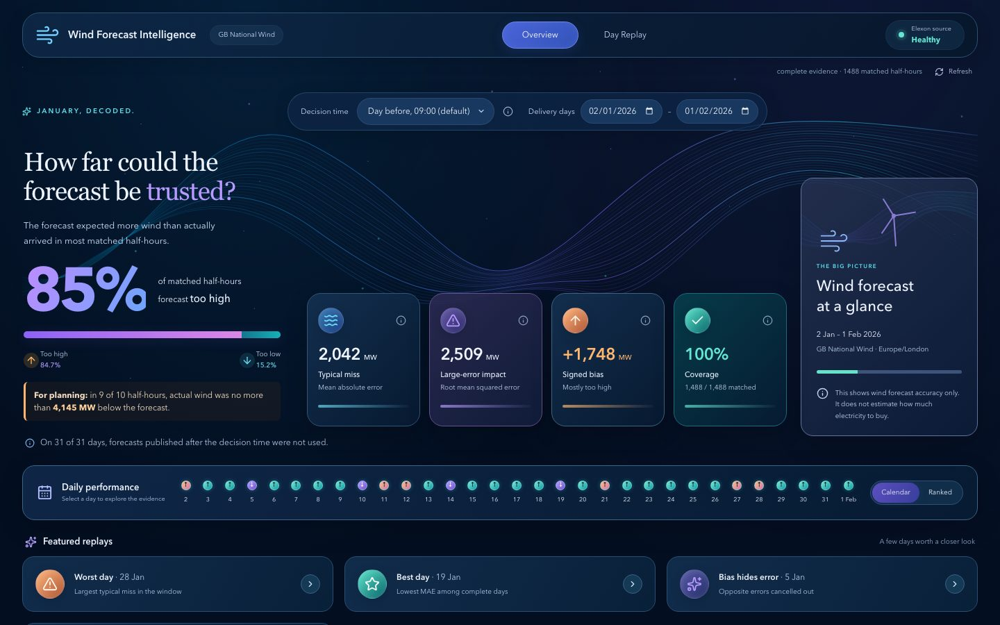
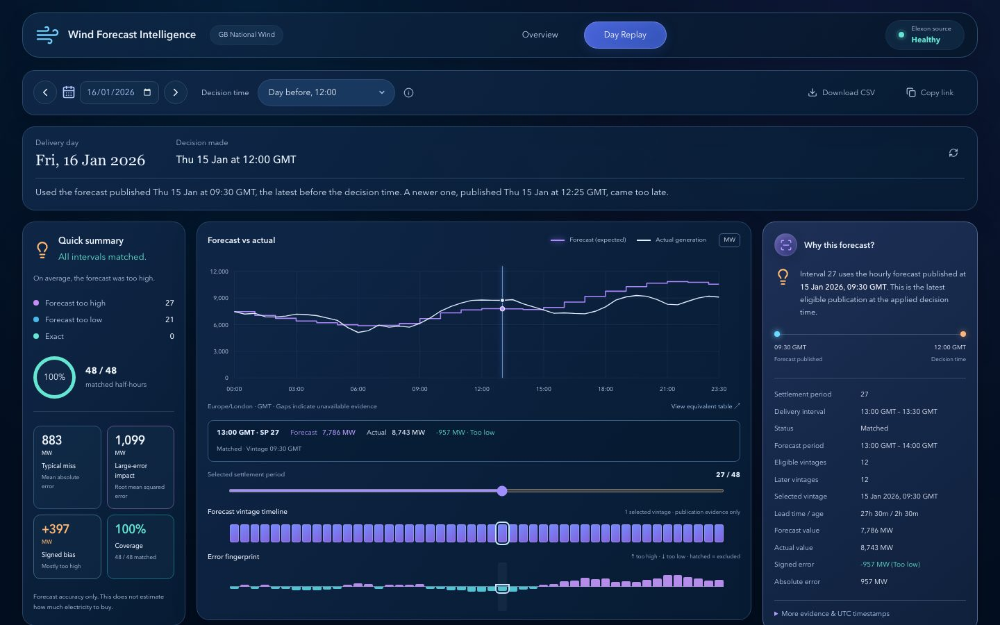
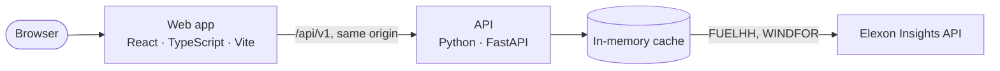

# Wind Forecast Intelligence

[](https://tiszri.vercel.app)
[](https://github.com/vijayfagaria-dev/tiszri/actions/workflows/ci.yml)


**See GB wind forecasts the way a day-ahead buyer saw them, and how far off they were.**

A utility buying power on the GB day-ahead market has to decide the day before delivery, relying
on wind forecasts. This app replays any day in January 2026 at the moment the decision was made:
which forecast was the latest available, what actually happened, and how big the error was. It
uses Elexon data only.

**[Open the live app →](https://tiszri.vercel.app)**

| Overview | Day Replay |
|---|---|
|  |  |

## Contents

- [Features](#features)
- [Quick start](#quick-start)
- [How it works](#how-it-works)
- [Architecture](#architecture)
- [API](#api)
- [Testing](#testing)
- [Configuration](#configuration)
- [Deployment](#deployment)
- [Limitations](#limitations)
- [AI Assistance](#ai-assistance)

## Features

- **Day Replay.** Pick a delivery day and a decision time to see the forecast that was available
  then, against actual wind generation, half-hour by half-hour. The page opens with the answer,
  for example *"Used the forecast published Thu 15 Jan at 09:30 GMT. A newer one, published at
  12:25, came too late."*
- **Accuracy overview.** MAE, RMSE, bias and coverage for any window of January, the error
  distribution, a day-by-day view, and the best and worst days. A planning line puts the risk in
  MW: *"in 9 of 10 half-hours, actual wind was no more than 4,145 MW below the forecast."*
- **Any decision time.** The usual choices (the day before at 09:00 or 12:00, two days before) or
  any day and time from a week before to two days after delivery.
- **Honest about gaps.** Missing, late, conflicting or invalid data is shown and explained, never
  treated as zero or silently filled from an older forecast.
- **Shareable and exportable.** Every view is a URL, and each day downloads as CSV.
- **Documented API.** Every response follows an OpenAPI 3.1 contract
  ([`contracts/openapi.yaml`](contracts/openapi.yaml)).

The app measures wind forecast accuracy. It does not estimate how much electricity to buy: that
also needs demand and other data outside this scope.

## Quick start

**Docker** (web app on http://localhost:8080, API on http://localhost:8000):

```bash
docker compose up --build                         # live Elexon data
SOURCE_MODE=fixtures docker compose up --build    # recorded January data, works offline
```

**Locally** (Python 3.12 with [uv](https://docs.astral.sh/uv/), Node 22 with Yarn 1;
`corepack enable` provides Yarn):

```bash
make setup    # install backend and frontend dependencies
make dev      # API on http://localhost:8000
make web      # in a second terminal: web app on http://localhost:5173
```

`cd frontend && yarn dev` runs the web app alone on built-in demo data. `make help` lists every
command.

## How it works

1. **Data.** Actual generation is Elexon FUELHH filtered to `fuelType = WIND` (half-hourly MW).
   Forecasts are Elexon WINDFOR: about eight versions a day, each an hourly forecast for the next
   three days.
2. **What was knowable.** For each hour, only forecasts published at or before the decision time
   count (one published exactly at that time does), and the latest of them is used. A later
   forecast is never used, and an older one is never used as a fallback: if the latest is missing,
   invalid or has conflicting duplicates, that hour is excluded and the reason shown.
3. **Matching.** Each hourly forecast applies to both half-hour settlement periods of its hour.
   Matching only the half-hours that start on the hour changes January's MAE from 2,042 to 2,022
   MW, so the choice barely matters; the API reports both.
4. **Metrics.** Error = forecast − actual, so positive means the forecast was too high. MAE, RMSE
   and bias use matched half-hours only, pooled across days; missing values are excluded and
   counted, never treated as zero.
5. **Time.** Comparisons are in UTC; days and times are shown in UK time. Clock-change days have
   46 or 50 half-hours.

The default decision time is 09:00 UK time the day before delivery, just before the GB
day-ahead auctions close. It is a default, not a market rule.

**What January 2026 shows** (decisions at 09:00 the day before):

| | |
|---|---|
| Typical miss (MAE) | 2,042 MW |
| Average bias | +1,748 MW (forecast too high in 85% of half-hours) |
| 9-in-10 shortfall (P90) | Actual wind at most 4,145 MW below forecast |
| Notable day | 15 Jan: the 11:30 forecast was published at 12:25, so a noon decision used the 09:30 one |

## Architecture



- **Contract first.** [`contracts/openapi.yaml`](contracts/openapi.yaml) was written before the
  code so the frontend and backend could be built in parallel; tests hold both sides to it.
- **Pure analysis core.** Forecast selection and metrics do no I/O, so the rules are tested
  exhaustively. Data sources (the Elexon client, recorded data, the cache) share one small
  interface and are interchangeable.
- **Checked results.** Every analysis is checked before it is returned: counts add up, nothing
  published after the decision time was used, and RMSE ≥ MAE ≥ |bias|.
- **Fast.** Elexon responses are cached in memory and analyses are cacheable by URL, so changing
  the decision time for a day takes milliseconds.

```text
backend/     Python FastAPI service: app/ (api, services, analysis, clients, models, schemas), tests/
frontend/    React web app; see frontend/README.md
contracts/   openapi.yaml, recorded Elexon data and generated example responses
docker-compose.yml · vercel.json · Makefile · .github/workflows/
```

<details>
<summary>Backend packages</summary>

| Package | Responsibility |
|---|---|
| `api/` | HTTP routes, query-parameter validation, error mapping, middleware |
| `services/` | Load the data a request needs and run the analysis |
| `analysis/` | Pure calculation: forecast selection, matching, metrics, warnings, summaries |
| `clients/` | Elexon HTTP client, recorded data and cache behind one interface; row parsing |
| `models/` | Plain dataclasses and enums shared by the layers |
| `schemas/` | Response models that serialise to the contract |
| `core/`, `utils/` | Settings, error types, date and time helpers |

</details>

## API

| Endpoint | Returns |
|---|---|
| `GET /api/v1/wind-analysis` | One delivery day at a decision time: each half-hour's forecast and actual, metrics, coverage, warnings |
| `GET /api/v1/wind-analysis/export` | The same as CSV, one row per half-hour |
| `GET /api/v1/accuracy-summary` | Accuracy pooled over a window, error distribution, daily results, notable days |
| `GET /api/v1/forecast-versions` | Every forecast version covering a day, hour by hour |
| `GET /api/v1/metadata` | Supported dates, decision-time presets, units, rules, metric definitions |
| `GET /api/v1/health/live`, `/health/ready` | Liveness and readiness |

```bash
curl "https://tiszri.vercel.app/api/v1/wind-analysis?deliveryDate=2026-01-16&cutoffDayOffset=-1&cutoffLocalTime=12:00"
curl "https://tiszri.vercel.app/api/v1/accuracy-summary"
```

The decision time is a rule relative to the delivery day (`cutoffDayOffset=-1&cutoffLocalTime=09:00`)
or an exact instant (`decisionCutoff=2026-01-15T09:00:00Z`); without either, the default applies.
Errors share one JSON shape with a stable code. Each analysis carries a `resultHash`, so two people
can confirm they are looking at identical results.

## Testing

```bash
make ci                                      # backend: lint, types, tests
cd frontend && yarn test && yarn test:e2e    # frontend: unit and browser tests
```

- **Backend:** unit tests (parsing, time zones including both 2026 clock changes, selection,
  metrics); property tests with Hypothesis (a forecast published after the decision time is never
  used, the newest eligible one always wins); recorded-data scenarios with exact expected values,
  cross-checked against a separate naive implementation; API tests validated against the contract.
- **Frontend:** unit and component tests, every backend example response run through the
  frontend's runtime checks, and Playwright browser tests for the main workflows, request races,
  offline state, layouts from 320 px to 1440 px, and accessibility (axe).
- **Live data:** `make live` checks that Elexon still returns the shape, resolution and history
  the service relies on; a scheduled workflow runs it daily.

CI runs all of this on every push, plus a dependency audit and both Docker builds.

## Configuration

Settings come from environment variables; see [`backend/.env.example`](backend/.env.example).
No secrets are needed.

| Variable | Default | Meaning |
|---|---|---|
| `SOURCE_MODE` | `http` | `http` for live Elexon data, `fixtures` for recorded data (not allowed in production) |
| `CACHE_ENABLED` / `CACHE_TTL_S` | `true` / `21600` | In-memory cache of Elexon responses |
| `DEFAULT_CUTOFF_DAY_OFFSET` / `DEFAULT_CUTOFF_LOCAL_TIME` | `-1` / `09:00` | Default decision time |
| `SUPPORTED_DATE_FROM` / `SUPPORTED_DATE_TO` | `2026-01-01` / `2026-02-01` | Delivery dates that can be analysed |

## Deployment

The live app runs on Vercel as one project with two
[services](https://vercel.com/docs/services), configured in [`vercel.json`](vercel.json): the
static web app, and the FastAPI backend as a Vercel Function. `/api/*` goes to the backend and
everything else to the web app, so both share one domain and need no CORS. The CDN caches each
analysis by URL. Set `APP_ENV=production` in the project's environment variables. `vercel dev`
runs both services locally.

## Limitations

- GB national wind only, for decisions made in January 2026 (delivery days 1 January to
  1 February).
- WINDFOR does not document whether an hourly value is an average or a point value. Results are
  insensitive to this (see *Matching* above), but the mapping is a stated assumption.
- The forecast ran about 1.7 GW too high on average; the causes (for example curtailment, or the
  two datasets covering different wind farms) are not assessed.

## AI Assistance

Claude Code was used occasionally for Elexon API research and to assist with parts of the
implementation and testing. The final code and analysis were reviewed and checked against recorded
Elexon data and expected results.
